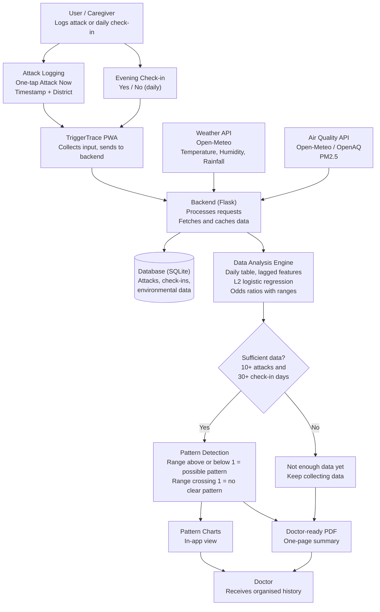

# TriggerTrace

**Link every asthma attack to the air around it.**

> **Theme:** SDG 3, Good Health and Well-being
> **Version:** 1.0 (hackathon prototype)

TriggerTrace is an installable **Progressive Web App (PWA)** that helps people with asthma discover their **possible environmental triggers**. It connects each recorded attack with air quality and weather data, then shows **possible patterns** and a one-page **doctor-ready PDF** summary.

---

## Table of Contents

- [Overview](#overview)
- [Problem Statement](#problem-statement)
- [Proposed Solution](#proposed-solution)
- [Key Features](#key-features)
- [Tech Stack](#tech-stack)
- [How It Works](#how-it-works)
- [Architecture](#architecture)
- [Analysis Approach](#analysis-approach)
- [Privacy and Safety](#privacy-and-safety)
- [Repository Structure](#repository-structure)
- [Getting Started](#getting-started)
- [Limitations](#limitations)
- [Future Scope](#future-scope)
- [Expected Impact](#expected-impact)
- [License](#license)

---

## Overview

People with asthma are often told to **avoid their triggers**, but most do not know what their triggers are. TriggerTrace makes recording an attack take about **two seconds** and automatically attaches the **PM2.5, humidity, temperature and rainfall** for that time and place. Over time, it compares **attack days** with **confirmed symptom-free days** to highlight **possible patterns**.

---

## Problem Statement

- Triggers differ from person to person, so attacks often feel **random**.
- **Weather and air quality apps** show conditions for everyone, not linked to an individual's attack history.
- **Symptom diaries** record attacks but not the environment, and are hard to fill in during an attack.
- Patients often reach consultations **relying on memory**, so doctors receive an incomplete picture.

---

## Proposed Solution

TriggerTrace provides:

- **One-tap logging** of attacks inside the app
- **Automatic environmental data** attached to every entry
- **Pattern analysis** using logistic regression, with **confidence notes**
- A **doctor-ready PDF** summary for better consultations

---

## Key Features

| Feature | Description |
|---|---|
| **One-tap attack logging** | An "Attack Now" button records the timestamp and district in about two seconds |
| **Environmental data tracking** | PM2.5, humidity, temperature and rainfall are attached automatically |
| **Follow-up recording** | Severity and inhaler use are asked **30 to 60 minutes later**, when the user is calm |
| **Back-dated entries** | Attacks can be added afterwards and are tagged **"logged later"** |
| **Evening check-ins** | A one-tap "Any symptoms today?" builds the **symptom-free baseline** |
| **Pattern detection** | **Regularized logistic regression**, with a simple attack-rate comparison as a sanity check |
| **Confidence indicators** | Shows a possible pattern with an uncertainty range, or says **"not enough data"** |
| **Doctor-ready PDF** | One-page summary of attack history and observed patterns |
| **Caregiver mode** | Caregivers can log attacks for children and older adults |
| **Offline support** | Environmental data is cached, and logging works offline and syncs later |

---

## Tech Stack

| Layer | Technology | Purpose |
|---|---|---|
| **Frontend** | React (Vite), installable PWA | User interface, one-tap logging, charts |
| **Backend** | Python, Flask | API, data fetching, analysis, PDF generation |
| **Database** | SQLite | Attack records, check-ins, cached environmental data |
| **Weather data** | Open-Meteo | Temperature, humidity, rainfall |
| **Air quality data** | Open-Meteo Air Quality / OpenAQ | PM2.5 |
| **Analysis** | pandas, scikit-learn | Daily table, L2 logistic regression, bootstrapped ranges |
| **Charts** | Recharts or Chart.js | Pattern charts in the app |
| **PDF reports** | ReportLab | One-page doctor summary |

---

## How It Works

1. The user taps **Attack Now**, and the app stores the **timestamp and district**.
2. The backend attaches **historical air quality and weather** for that time and place.
3. The user adds **follow-up details** (severity, inhaler use) and completes **evening check-ins**.
4. The backend builds a **daily table**: one row per day, with attack yes or no, plus same-day and previous 1 to 2 day values.
5. Only **checked-in days** count as symptom-free. Days with no check-in are **excluded**, never assumed to be symptom-free.
6. **Logistic regression** estimates the **odds ratio** for each factor, with **bootstrapped ranges**.
7. The app shows **possible patterns** with confidence notes. If the data is thin or the range includes "no effect", it says so.
8. The user can generate a **doctor-ready PDF**.

---

## Architecture

TriggerTrace has five layers: the **PWA** collects user input, **external APIs** provide weather and air quality, the **Flask backend** stores and processes data, the **SQLite database** holds records, and the **analysis engine** produces possible patterns and the doctor report.



> **Note:** Results are **possible patterns, not causes**.

For the full component details, see **[Architecture details](docs/architecture.md)**.

---

## Analysis Approach

| Item | Approach |
|---|---|
| **Target** | Attack that day (yes or no) |
| **Features** | PM2.5, humidity, temperature, rainfall (same-day and lagged) |
| **Model** | **L2-regularized logistic regression** on standardized features |
| **Output** | **Odds ratios** with ranges, described as **possible patterns** |
| **Fallback** | Simple **attack-rate comparison** as a sanity check |
| **Minimum data** | **10 attacks** and **30 check-in days** (proposed, to be tuned) |

> **Important:** Results are **possible patterns, not causes**.

---

## Privacy and Safety

- The prototype uses **synthetic data only**. No real patient data is used.
- Only **district-level location** is stored.
- Data is protected in transit with **HTTPS**.
- Users can **delete their data**.
- TriggerTrace **does not provide diagnosis or treatment recommendations**.

> **Emergencies come first:** during a severe attack, follow your asthma action plan or call emergency services. Log the attack afterwards.

---

## Repository Structure

```
triggertrace/
├── README.md
├── LICENSE
├── .gitignore
├── .env.example
├── docs/
│   ├── PRD.md
│   ├── architecture.md
│   └── pitch/
├── backend/
│   ├── app.py
│   ├── config.py
│   ├── db.py
│   ├── schema.sql
│   ├── requirements.txt
│   ├── routes/
│   ├── services/
│   └── tests/
├── data/
│   ├── generate_synthetic.py
│   ├── synthetic_sample.csv
│   └── cache/
└── frontend/
    ├── package.json
    ├── vite.config.js
    ├── index.html
    ├── public/
    └── src/
```

---

## Getting Started

### Prerequisites

- Python 3.10 or newer
- Node.js 18 or newer
- Git

### Backend

```bash
cd backend
python -m venv venv
source venv/bin/activate        # Windows: venv\Scripts\activate
pip install -r requirements.txt
python app.py
```

### Frontend

```bash
cd frontend
npm install
npm run dev
```

### Configuration

Copy the example settings file and fill in the values:

```bash
cp .env.example .env
```

> **Never commit your real `.env` file.** It is listed in `.gitignore`.

---

## Limitations

- A small number of logged attacks **cannot prove a trigger**.
- Air quality data may be **coarse** for some districts.
- **Pollen** is not included, because reliable data for India is limited.

---

## Future Scope

- Home-screen widget and lock-screen shortcut for faster logging
- Smart inhaler sensor integration
- Smartwatch-based attack detection
- Voice-based logging
- Tamil and other regional language support
- Telegram and WhatsApp integration
- Clinic-based pilot testing
- Extension to migraines, allergies and eczema

---

## Expected Impact

TriggerTrace aims to **improve asthma awareness**, help individuals understand their **personal environmental patterns**, and give doctors **more organised health histories**.

---

## License

This project is licensed under the **MIT License**. See [LICENSE](LICENSE) for details.

---

*Built with the vision of making healthcare awareness smarter, simpler and more accessible.*
