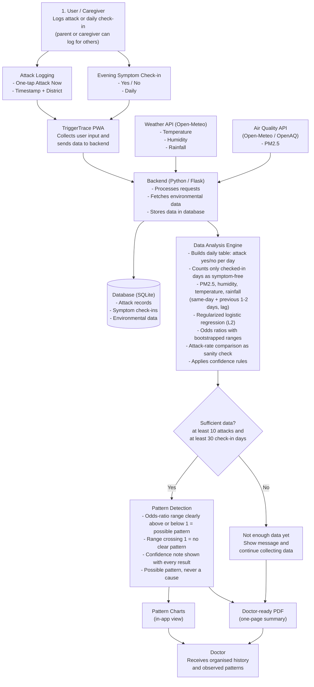

# TriggerTrace Data Flow

Link every asthma attack to the air around it.

## Component details

**1. User / Caregiver**
Logs an attack or the daily check-in. A parent or caregiver can log for children and older adults.

**Attack Logging**
- One-tap "Attack Now" button records the timestamp and district.
- Follow-up severity and inhaler use are asked later.

**Evening Symptom Check-in**
- Daily Yes / No question about symptoms.
- Only checked-in days count as symptom-free.

**TriggerTrace PWA**
The installable React app collects user input and sends it to the backend.

**Weather API (Open-Meteo)**
Provides temperature, humidity and rainfall for the user's district and time.

**Air Quality API (Open-Meteo / OpenAQ)**
Provides PM2.5 for the user's district and time.

**Backend (Python / Flask)**
Processes requests, fetches and caches environmental data, and stores everything in the database.

**Database (SQLite)**
Stores attack records, symptom check-ins and environmental data.

**Data Analysis Engine**
- Builds a daily table with one row per day: attack yes or no.
- Uses PM2.5, humidity, temperature and rainfall, same-day and lagged (previous 1 to 2 days).
- Runs L2-regularized logistic regression on standardized inputs.
- Reports odds ratios with bootstrapped ranges.
- Runs a simple attack-rate comparison as a sanity check.
- Applies the confidence rules.

**Sufficient Data?**
Analysis runs as a pattern only when there are at least 10 attacks and at least 30 check-in days (proposed thresholds, to be tuned).

**Pattern Detection**
- A factor is a possible pattern when its odds-ratio range sits clearly above or below 1.
- A range that crosses 1 is reported as "no clear pattern."
- Every result carries a confidence note.
- Results are described as possible patterns, never causes.

**Not enough data yet**
Shows a message and keeps collecting data.

**Pattern Charts (in-app view)**
Shows the patterns and confidence notes in the app.

**Doctor-ready PDF (one-page summary)**
Summarises attack history and observed patterns for the doctor.

**Doctor**
Receives an organised history and the observed patterns.

